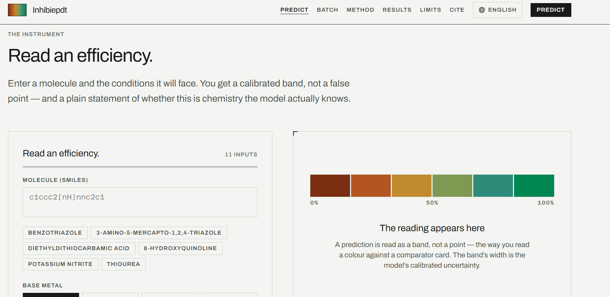

# Inhibitor Efficiency Predictor

**Integrating Artificial Intelligence (AI) with Quantum Mechanics for Predictive Modelling of
the Corrosion Inhibition Process of Some Metals**

Research artefacts, trained-model contract, run archive and reproducibility record for a
doctoral study in the Department of Chemistry, University of Uyo.

[](LICENSE)
[](LICENSE-DATA)
[](https://www.python.org/)
[](provenance/manifest.json)

---

## What this is

A quantitative structure–property relationship (QSPR) framework that predicts the **corrosion
inhibition efficiency (IE, %)** of an organic molecule on a given metal **under stated
experimental conditions**, and reports how far that prediction can be trusted.

The study assembled 8,359 inhibition measurements of 1,050 molecules from three public
databases, harmonised them to a single schema, recovered solution pH from the recorded
electrolyte, and benchmarked fifteen model configurations across five families on identical
cross-validation folds under three partitioning schemes.

Its central finding is methodological rather than architectural. **Under the row-wise
cross-validation convention used almost universally in this literature, 94.5 % of the
molecules a model is asked to predict have already been seen during training.** Correcting
that reduces explained variance by a mean of 0.310 across twelve models — and reproducing a
published protocol on its authors' own data reduces their figure by a comparable 0.278. The
inflation is a property of the field's evaluation convention, not of any one pipeline.

> **Live prediction service:** **[inhibiepredict.com](http://inhibiepredict.com)**
> — enter a molecule and its service conditions, receive a calibrated band with an explicit
> applicability-domain verdict.

[](http://inhibiepredict.com)

<sub>The deployed interface. A prediction is returned as a band, not a point, because the
measurements the model is trained on are themselves reproducible only to about 8.8 efficiency
points.</sub>

---

## The honest figures

Three numbers can be computed from this work. Only two of them are estimates of predictive
skill, and this repository reports those two together, everywhere, without exception.

| Scheme | R² | MAE | What it answers |
|---|---|---|---|
| **Grouped by molecule** | **0.461** | **15.65** | How the model performs on a compound it has never seen. **The headline.** |
| **Bemis–Murcko scaffold** | **0.398** | 17.32 | How it performs on a chemical family it has never seen. |
| Row-wise *(control only)* | 0.817 | 7.77 | Nothing about prediction — 94.5 % of its test molecules were in training. |

**R² 0.817 is not a performance claim and is never quoted as one.** It is reported solely to
measure how much a row-wise split overstates the outcome. It is the number this study exists
to refute.

Two further figures belong beside any error we report:

- **Every prediction carries an interval.** The 90 % split-conformal interval is **±38.6
  efficiency points**, with 92.6 % empirical coverage, calibrated on a partition disjoint at
  the level of the molecule. A bare point estimate invites a reader to treat it as exact.
- **Two independent laboratory measurements of the same experiment differ by about 8.8
  efficiency points.** The model's 15.65-point error is **1.77×** that reproducibility floor,
  not 15.65× some implicit ideal of zero. Much of the remaining error is in the published
  record, not in the model.

---

## What the model measures

### Inputs

A prediction is defined by a molecule *and* the conditions it will face. Supplying the
structure alone explains under 17 % of the variance.

| Variable | Type | Units / vocabulary | Notes |
|---|---|---|---|
| `smiles` | text | SMILES | Canonicalised and salt-stripped before featurisation |
| `metal` | categorical | `Al`, `Cu`, `Fe`, `Mg` | Base metal. Zinc (33 rows) fell below the support threshold |
| `alloy` | categorical | 38 encoded grades | e.g. `Carbon steel`, `AA2024`, `AZ31`. Thin-support grades pool to `other_alloy` |
| `methodology` | categorical | 11 techniques | e.g. `potentiodynamic polarisation`, `gravimetric`. Others pool to `other_method` |
| `temperature_K` | numeric | K | Carried with its reciprocal, because Arrhenius behaviour is linear in 1/T |
| `duration_h` | numeric | hours | Carried with log₁₀. Absent on 33 % of the corpus — "not recorded" is a supported answer |
| `concentration_mM` | numeric | mM | Carried as log₁₀, because adsorption isotherms are linear in log C |
| `pH` | numeric | −2 to 16 | A model feature. Negative values are real: the corpus runs to −1.0 in concentrated acid |
| `ph_source` | categorical | `measured`, `derived`, `banded`, `missing` | How the pH was established, so the model can discount an inferred value |
| `salt_concentration_M` | numeric | mol/L | Carried as log₁₀ |
| `synergist_present` | binary | 0 / 1 | Whether a synergistic additive was present |

Each numeric condition is accompanied by a **was-missing indicator**, so the model can learn a
different response to an imputed value than to a measured one. Unrecorded conditions are
normal in this literature, not exceptional.

### Output

**Inhibition efficiency, as a percentage on [0, 100]** — the fraction by which the corrosion
rate is reduced:

```
IE (%) = (CR₀ − CR₁) / CR₀ × 100
```

returned with a 90 % conformal interval, an applicability-domain verdict (nearest-neighbour
Tanimoto similarity, scaffold membership and a condition-envelope check), and the
documented failure modes that apply to the requested alloy and technique.

### The feature vector

283 columns, in the order given by [`model/contract.json`](model/contract.json) →
`feature_names`, which is the single source of truth.

| Block | Columns | Contents |
|---|---|---|
| Physicochemical descriptors | 211 | of 217 RDKit descriptors; six are zero-variance |
| Numeric conditions | 7 | temperature, 1/T, duration, log₁₀ duration, log₁₀ concentration, pH, log₁₀ salt |
| Was-missing indicators | 7 | one per numeric condition |
| Base metal | 4 | Al, Cu, Fe, Mg |
| Alloy designation | 38 | grades with ≥ 30 supporting rows |
| Measurement methodology | 11 | techniques with ≥ 25 supporting rows |
| pH provenance | 4 | measured, derived, banded, missing |
| Synergist | 1 | binary |

---

## Scope

**In scope.** Single organic molecules; four base metals (Fe, Al, Mg, Cu) and 77 alloy
designations; acidic, near-neutral and alkaline aqueous media; eleven measurement techniques;
temperature, exposure duration, inhibitor concentration, pH and supporting-salt concentration
as explicit model inputs.

**Out of scope, and not represented in the training corpus at all.** Inorganic inhibitors,
counterion salts and mixtures; zinc substrates; atmospheric corrosion; microbiologically
influenced corrosion; erosion and stress-corrosion cracking. The corpus is dominated by acidic
media (4,726 rows against 538 alkaline), so alkaline performance rests on a much smaller
evidential base.

**This is a screening and prioritisation instrument, not an engineering qualification.** With
a ±38.6-point interval, its value lies in ranking candidates for laboratory work. It does not
replace electrochemical or weight-loss testing, and a prediction is not evidence that a
chemical is safe or environmentally acceptable.

---

## Repository layout

```
.
├── notebook/      the executed pipeline, 161 cells with all stored outputs
├── data/          the harmonised corpus, fold indices and preprocessing audit
├── metrics/       16 result tables and the tuning record, as written by the run
├── figures/       all 25 figures from the run archive
├── model/         the 283-column feature contract and reference predictor (no weights)
├── provenance/    the run manifest and the recorded runtime specification
├── assets/        the web-interface screenshot
└── docs/          DATA, METHODS, MODELS, RESULTS, FIGURES, REPRODUCIBILITY, LIMITATIONS
```

| Document | What it covers |
|---|---|
| [`docs/DATA.md`](docs/DATA.md) | The three sources, harmonisation, pH recovery, deduplication, schema |
| [`docs/METHODS.md`](docs/METHODS.md) | The seven-stage pipeline, the three partitioning schemes, leakage control |
| [`docs/MODELS.md`](docs/MODELS.md) | All fifteen configurations and their hyperparameters |
| [`docs/RESULTS.md`](docs/RESULTS.md) | Every result table, including subgroups and validation |
| [`docs/FIGURES.md`](docs/FIGURES.md) | Each figure with its caption and chapter cross-reference |
| [`docs/REPRODUCIBILITY.md`](docs/REPRODUCIBILITY.md) | Environment, seeds, how to re-run, notebook errata |
| [`docs/LIMITATIONS.md`](docs/LIMITATIONS.md) | What is not established, and where the model must not be trusted |

---

## Data sources

No new corrosion measurements were generated for the modelling component. The corpus was
assembled from three public sources, harmonised to a common schema of fifteen fields.

| Source | Rows exported | Fields | Metals | Carries |
|---|---|---|---|---|
| **CORDATA** | 5,000 | 17 | Al, Cu, Fe, Mg, Zn | pH, duration, methodology, salt, synergist |
| **ExCorr** | 4,616 | 35 | Al, Cu, Fe, Mg, Zn | pH on 21.8 % of rows, duration, methodology |
| **Inhibitor 1368** | 1,364 | 30 | Fe (carbon steel in 1 M HCl) | DFT quantum descriptors on a subset |

> Galvão, T. L. P., Ferreira, I., Kuznetsova, A., Rocha, A. B., Tedim, J., & Ferreira, M. G. S.
> (2022). CORDATA: An open data management web application to select corrosion inhibitors.
> *npj Materials Degradation, 6*, 48. https://doi.org/10.1038/s41529-022-00259-9
>
> Würger, T. (n.d.). *ExCorr: An interactive corrosion inhibitor database* [Web application].
> Helmholtz-Zentrum Hereon. https://excorr.web.app
>
> Gong, H., Fu, Z., Ma, L., & Zhang, D. (2024). Inhibitor_Mol_VAE: A variational autoencoder
> approach for generating corrosion inhibitor molecules. *npj Materials Degradation, 8*(1),
> 102.

**Please cite the original sources, not only this repository, when you use the corpus.** The
file [`data/master_table.csv`](data/master_table.csv) is a derived, harmonised and deduplicated
work; the measurements in it belong to the three databases above and, through them, to the
primary publications they compile. [`docs/DATA.md`](docs/DATA.md) records what was changed and
why.

---

## Results in brief

### The evaluation protocol is the result

| Scheme | Validation molecules per fold | Already seen in training | % seen |
|---|---|---|---|
| Row-wise (control) | 670.0 | 633.0 | **94.5** |
| Grouped by molecule | 210.0 | 0.0 | 0.0 |
| Scaffold | 210.0 | 0.0 | 0.0 |

Correcting the convention costs a mean of **0.310 R²** across twelve models. The same
correction applied to a published study, on that study's own data and features, reduced its
figure from 0.657 to 0.379 — an inflation of **0.278**. Two independent measurements of the
same artefact.

### The benchmark

Fifteen configurations, identical folds, identical inputs, one evaluation harness. Ordered by
the honest scheme.

| Family | Model | Row-wise | **Grouped** | Scaffold |
|---|---|---|---|---|
| Classical | XGBoost | 0.812 | **0.464** | 0.398 |
| Classical | Random forest | 0.817 | **0.461** | 0.398 |
| Hybrid | H1, graph encoder → boosting | 0.774 | **0.451** | 0.247 |
| Classical | Gradient boosting | 0.679 | 0.443 | 0.331 |
| Classical | SVR (RBF) | 0.617 | 0.411 | 0.323 |
| Hybrid | H2, transformer embedding → boosting | 0.791 | 0.411 | 0.350 |
| Transformer | ChemBERTa, fine-tuned | 0.572 | 0.364 | 0.253 |
| Graph | GAT with condition fusion | 0.624 | 0.362 | 0.109 |
| Hybrid | H3, three-branch fusion | 0.663 | 0.337 | 0.155 |
| Graph | MPNN with condition fusion | 0.670 | 0.335 | 0.057 |
| Neural | Feedforward MLP | 0.764 | 0.303 | 0.094 |
| Classical | Ridge | 0.534 | 0.256 | −0.407 |
| Classical | Random forest, structure only | — | 0.167 | 0.107 |
| Classical | XGBoost, structure only | — | 0.153 | 0.105 |
| Baseline | Mean predictor | −0.000 | −0.014 | −0.071 |

**Three models share the lead, and no ranking separates them.** Pairwise Wilcoxon signed-rank
tests on out-of-fold absolute errors place XGBoost, the random forest and the H1 hybrid in one
tier within which no pair differs significantly (p = 0.201, 0.641, 0.725). The 0.003 between
XGBoost and the random forest is smaller than either model's fold-to-fold standard deviation.

Note also that **the ordering changes between schemes**: the feedforward network ranks fifth
row-wise and eleventh when grouped. A leaderboard built on the row-wise convention would
recommend a different model.

### The experimental conditions contribute more than the structure

| Scheme | Structure only | Structure + conditions | Gain |
|---|---|---|---|
| Grouped by molecule | 0.167 | 0.461 | **+0.293** |
| Scaffold | 0.107 | 0.398 | **+0.291** |

A model given only the molecule explains under seventeen per cent of the variance. The same
estimator, folds and metric, given the conditions as well, explains forty-six. The near-equal
gain under two different partitions indicates this is the information, not a partition
artefact. **A prediction is meaningful only when the service conditions are specified
alongside the structure.**

Cumulative ablation attributes it block by block: conditions **+0.234**, substrate **+0.056**,
methodology **+0.010**, fingerprints **+0.010** for an eightfold increase in dimensionality
(and were not retained), pH provenance **−0.005** — carried for transparency about how each pH
was established, not for predictive gain. Quantum-chemical descriptors, evaluated on the
2,895 rows that carry them, **reduced** explained variance from 0.264 to 0.167.

### Where the model should not be trusted

Aggregate scores conceal subgroup failure, so performance is disaggregated and published
rather than averaged away.

- **Measurement technique is the strongest axis of variation**: from R² 0.461 on
  potentiodynamic polarisation to **−0.421 on current density**. Gravimetric measurement
  (n = 1,730) and polarisation resistance return negative explained variance.
- **Four alloy designations show severe bias**: `Cold rolled steel` over-predicted by 30.0
  points, `Stainless steel` by 22.5, `Fe` by 16.1, `Steel` under-predicted by 18.8.
- **Iron needs care rather than a warning.** Its R² is −0.057 while its MAE, at 12.56, is the
  *best* of the four metals. Iron records cluster tightly at a high mean efficiency, so there
  is little variance to explain. This is why R² is reported alongside the error in the units
  of the target, and never alone.

[`docs/RESULTS.md`](docs/RESULTS.md) carries the full tables.

### Validation against experiment

Two constituents of African Spiral Flag extracts, identified by GC-MS and measured by weight
loss on aluminium in 1 M HCl at 303 K over 10 h:

| Extract | Principal constituent | Experimental IE | Predicted IE | Residual |
|---|---|---|---|---|
| Stem | (Z)-13-octadecenal | 85.0 % | 88.1 % | −3.1 |
| Leaf | 11-octadecenoic acid, methyl ester | 79.0 % | 86.9 % | −7.9 |

Both are over-predictions, and both absolute errors are smaller than the 15.7-point MAE for
unseen molecules. **Two observations cannot establish external validity**, and the study says
so. Against 30 published compounds the predictions correlate positively and significantly
(Pearson r = +0.496, p = 0.0053; Spearman ρ = +0.373, p = 0.0417).

For 20 compounds, the DFT HOMO–LUMO gap ΔE correlates **negatively but not significantly**
with predicted IE (r = −0.417, p = 0.067; ρ = −0.376, p = 0.102). The sign is the expected one
— smaller gap, higher efficiency — but the result does not support treating ΔE alone as
determining inhibition efficiency.

---

## Reproducing the work

The notebook is published exactly as executed, with all stored outputs, so every figure and
table can be traced to the cell that produced it without running anything.

```bash
git clone https://github.com/anneobot/Inhibitor-Efficiency-Predictor.git
cd Inhibitor-Efficiency-Predictor
jupyter lab notebook/corrosion-inhibitor-efficiency-qspr.ipynb
```

To recompute a published number from the archive instead:

```python
import pandas as pd

bench = pd.read_csv("metrics/benchmark_full.csv").drop_duplicates()
print(bench[bench.split == "grouped_molecule"]
           .sort_values("r2", ascending=False)[["model", "r2", "mae", "spearman"]])
```

Re-running the pipeline end to end needs an accelerated session with two T4-class GPUs and
about six hours, plus the three source exports, which are not redistributed here — obtain them
from the databases cited above. [`docs/REPRODUCIBILITY.md`](docs/REPRODUCIBILITY.md) gives the
full environment, the seeds, the fold protocol and the three errata in the notebook's own
narrative.

**No model weights are published in this repository.** The 283-column feature contract and the
reference predictor are in [`model/`](model/) so the featurisation is fully specified and
auditable; the fitted artefacts are available on request and are served at
[inhibiepredict.com](http://inhibiepredict.com). See [`model/README.md`](model/README.md).

---

## How to cite

**The thesis**

> Obot, A. S. (2026). *Integrating artificial intelligence (AI) with quantum mechanics for
> predictive modelling of corrosion inhibition process of some metals* [Doctoral thesis,
> University of Uyo].

```bibtex
@phdthesis{obot2026corrosion,
  author = {Obot, Anne Sylvanus},
  title  = {Integrating Artificial Intelligence (AI) with Quantum Mechanics for
            Predictive Modelling of Corrosion Inhibition Process of Some Metals},
  school = {University of Uyo, Department of Chemistry},
  year   = {2026},
  type   = {Doctoral thesis}
}
```

**This repository** — see [`CITATION.cff`](CITATION.cff), which GitHub renders under *Cite
this repository*.

**A specific prediction.** A prediction is reproducible only if the reader knows which
artefact produced it. Quote the run, the seed and the scheme:

> Predictions were obtained with the Inhibitor Efficiency Predictor
> (inhibiepredict.com, accessed YYYY-MM-DD). The served model is a random forest of 250 trees
> at maximum depth 31 over 283 features, trained on 8,359 measurements of 1,050 molecules
> across four base metals, from run `run_20260923_134752` with seed 42. Performance is
> R² = 0.461 (MAE 15.65) under five-fold cross-validation grouped by molecule, and R² = 0.398
> under a Bemis–Murcko scaffold split, the latter being the appropriate estimate for a
> structurally novel candidate. Predictions carry split-conformal intervals of ±38.6
> inhibition-efficiency points at 90 % nominal coverage. Featurisation used RDKit 2026.03.6.

---

## Licence

- **Code and the notebook** — [MIT](LICENSE).
- **The harmonised corpus, metrics, figures and documentation** —
  [CC BY 4.0](LICENSE-DATA). The underlying measurements remain the property of the three
  source databases and the primary publications they compile; cite those as well.

---

## Author and supervision

**Anne Sylvanus Obot** — BSc (Ed) (Hons.) (Uyo), MSc (Uyo) · 21/PG/FS/CH/PhD/004
Department of Chemistry, Faculty of Physical Sciences, University of Uyo, Akwa Ibom State,
Nigeria.

| Role | Name | Department |
|---|---|---|
| Supervisor | Dr Ekerete Jackson Boekom, Associate Professor | Chemistry, Physical Sciences |
| Co-supervisor | Prof. Philip Asuquo | Computer Engineering, Engineering |

### Acknowledgements

The three source databases and the primary researchers whose measurements they compile made
this work possible. Training was carried out on Kaggle Notebooks. Technical guidance on the
computational pipeline was provided by Mr Victor Jacob.

### Methodological references

Bemis & Murcko (1996) molecular frameworks · Breiman (2001) random forests · Chen & Guestrin
(2016) XGBoost · Rogers & Hahn (2010) extended-connectivity fingerprints · Gilmer et al.
(2017) neural message passing · Veličković et al. (2018) graph attention networks ·
Chithrananda et al. (2020) ChemBERTa · Akiba et al. (2019) Optuna · Lundberg & Lee (2017)
SHAP · Sundararajan et al. (2017) integrated gradients · Abnar & Zuidema (2020) attention
rollout · Vovk et al. (2005) and Lei et al. (2018) conformal prediction · Langmuir (1918)
adsorption · Wilcoxon (1945) signed-rank test · Kapoor & Narayanan (2023) leakage and the
reproducibility crisis · Landrum (2026) RDKit. Full entries in
[`docs/METHODS.md`](docs/METHODS.md).
